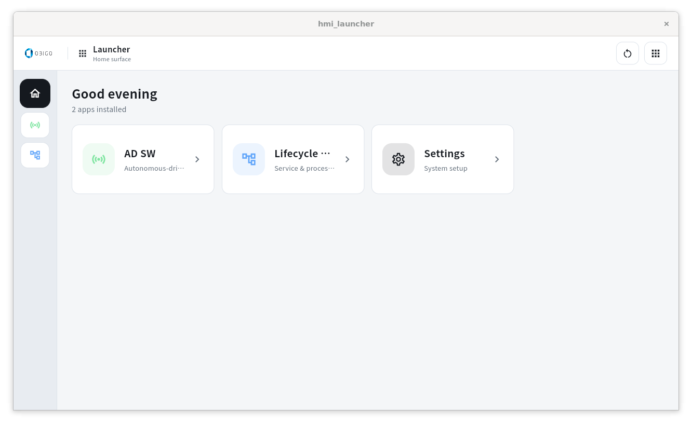
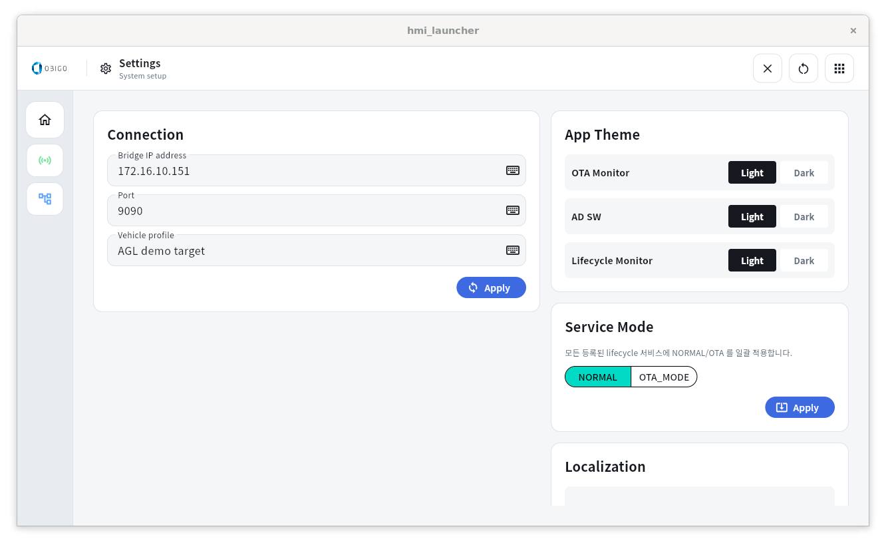
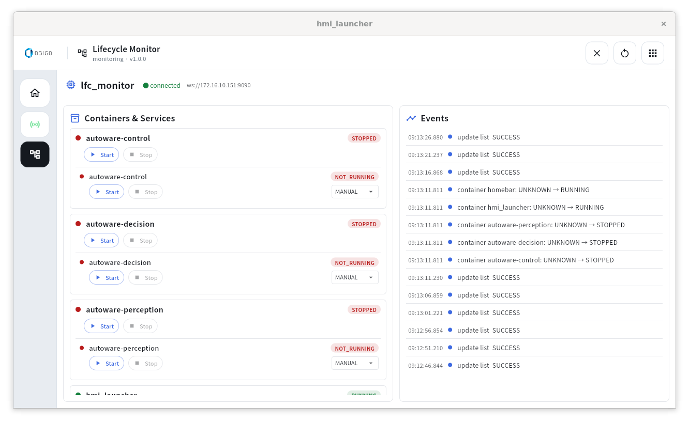

# MMF 및 자율주행 SW 시스템 종합 통합 테스트 절차서

본 문서는 MMF(Multi-SW Framework), Autoware(자율주행 SW), Security/IDS(침입 감지) 및 HMI 앱 간의 종합 통합 테스트를 위한 표준 절차서 및 체크리스트입니다.

---

## 1. 개요 및 시스템 테스트 환경

### 1.1 개요
본 테스트는 공통 Docker Compose 구성을 기반으로 **Orin 타겟 보드(HMI/AGL)**, **2세부 HW(MMF Core/ROS2 Ext/Security/Autoware)**, 그리고 **EVB 보드(우분투 데스크탑/RViz)** 간의 상호 연동 및 동작을 검증하는 것을 목적으로 합니다.

### 1.2 공통 Compose 및 환경 설정 파일
- **레포지토리**: `https://github.com/OSS-TEST-GROUP/oss_multisw_framework.git`
- **컴포즈 파일**: `docker/compose/docker-compose-integration.yaml`
- **환경 변수 파일**: `docker/compose/.env.integration`
- **서비스 등록/설정 파일**: `docker/compose/saved-service-list.yaml`

### 1.3 하드웨어별 역할 분담 및 컴포넌트 구성

| 구분 | 대상 하드웨어 / 환경 | 구동 서비스 / 역할 | 비고 |
|---|---|---|---|
| **Orin 보드** | NVIDIA Jetson Orin (또는 대체 x86_64 환경) | • `mmf-ext-agl` (AGL Extension)<br>• `hmi-launcher` (HMI 애플리케이션 서비스) | `mmf-ext-agl` 기동 시 `hmi-launcher`가 자동 연동 실행됨<br>*(Orin 미보유 환경은 x86_64 데스크탑/노트북으로 대체 가능)* |
| **2세부 HW** | Main Computing HW (x86_64 / AADP 등) | • `mmf-core` (Framework Core)<br>• `mmf-ext-ros2` (ROS2 Extension)<br>• Security 3종 (`security_processor`, `attack_env`, `security_monitor`) <br>• Autoware 3종 (`oss-adsw-decision`, `oss-adsw-control`, `oss-adsw-perception`) | Autoware는 **이미지 다운로드(Pull)**만 완료하고 HMI 제어를 통해 동적 기동 |
| **EVB 보드** | Ubuntu Desktop 환경 보드 | • `oss-adsw-rviz` (RViz 시각화 서비스)<br>• 자율주행 시뮬레이션 | ROS2 토픽 및 주행 데이터 수발신 시뮬레이션 환경 |

> [!NOTE]
> **Orin 미보유 개발 환경 안내 (x86_64 지원)**
> Orin 타겟 보드가 없는 개발사/업체의 경우, 동일한 `docker-compose-integration.yaml` 및 AGL/HMI 구성을 일반 x86_64 우분투 데스크탑/노트북 환경에서 그대로 구동하여 동일하게 테스트를 수행할 수 있습니다.

---

## 2. 사전 준비 및 서비스 기동 절차

### Step 2.1: 2세부 HW 대상 Docker 이미지 다운로드 (Pull)

**2세부 HW**에서 실행 및 동적 기동에 필요한 Docker 이미지들을 환경 변수 파일(`.env.integration`) 옵션과 함께 지정하여 다운로드합니다.

```bash
# 2세부 HW에서 실행
cd ~/source/oss_multisw_framework
docker compose --env-file docker/compose/.env.integration -f docker/compose/docker-compose-integration.yaml pull \
  mmf-core mmf-ext-ros2 security_processor attack_env security_monitor \
  oss-adsw-decision oss-adsw-control oss-adsw-perception
```

#### [터미널 실행 결과 첨부 양식]
```text
[+] pull 71/71
 ✔ Image ghcr.io/oss-test-group/oss-ids/security_processor:v0.1.0 Pulled          19.6s
 ✔ Image ghcr.io/oss-test-group/oss-ids/attack_env:v0.1.0         Pulled          20.8s
 ✔ Image registry.obigo.com/oss/oss-mmf-ext-ros2:latest           Pulled          64.8s
 ✔ Image junohb/autoware-partition:sample-adsw-control            Pulled          65.3s
 ✔ Image junohb/autoware-partition:sample-adsw-perception         Pulled          19.6s
 ✔ Image ghcr.io/oss-test-group/oss-ids/security_monitor:v0.1.0   Pulled          30.8s
 ✔ Image junohb/autoware-partition:sample-adsw-decision           Pulled          60.4s
 ✔ Image registry.obigo.com/oss/oss-mmf-core:latest               Pulled          31.1s
```

---

### Step 2.2: 2세부 HW 메인 프레임워크 및 보안 서비스 기동

2세부 HW에서는 MMF Core, ROS2 Extension 및 Security 서비스들을 기동합니다. (Autoware 서비스는 런타임 수동/HMI 제어를 위해 이미지 다운로드만 해두고 아직 기동하지 않음)

```bash
# 2세부 HW에서 실행
docker compose --env-file docker/compose/.env.integration -f docker/compose/docker-compose-integration.yaml up -d \
  mmf-core mmf-ext-ros2 security_processor attack_env security_monitor
```

#### [터미널 실행 결과 첨부 양식]
```text
[+] up 6/6
 ✔ Volume oss_monitor_db        Created             0.0s
 ✔ Container attack_env         Started             0.3s
 ✔ Container oss-mmf-core       Healthy             17.9s
 ✔ Container security_processor Started             0.3s
 ✔ Container security_monitor   Started             0.3s
 ✔ Container oss-mmf-ext-ros2   Started             18.1s
```

**실행된 컨테이너 상태 확인 명령어:**
```bash
docker ps
```

#### [터미널 실행 결과 및 스크린샷 첨부 양식]
```text
CONTAINER ID   IMAGE                                                      COMMAND                CREATED         STATUS                   NAMES
6a26e7b1e7eb   registry.obigo.com/oss/oss-mmf-ext-ros2:latest             "/oss/entrypoint.sh"   2 minutes ago   Up 2 minutes             oss-mmf-ext-ros2
c153f39fffcf   ghcr.io/oss-test-group/oss-ids/security_monitor:v0.1.0     "/entrypoint.sh"       2 minutes ago   Up 2 minutes             security_monitor
495a13bb6c37   registry.obigo.com/oss/oss-mmf-core:latest                 "/oss/entrypoint.sh"   2 minutes ago   Up 2 minutes (healthy)   oss-mmf-core
53ecbefd489c   ghcr.io/oss-test-group/oss-ids/security_processor:v0.1.0   "/entrypoint.sh"       2 minutes ago   Up 2 minutes             security_processor
f079e210a5c1   ghcr.io/oss-test-group/oss-ids/attack_env:v0.1.0           "/entrypoint.sh"       2 minutes ago   Up 2 minutes             attack_env
```

---

### Step 2.3: Orin 보드 (또는 x86_64 대체 환경) AGL 및 HMI 기동

Orin 타겟 보드에서 AGL Extension 서비스(`mmf-ext-agl`)를 기동합니다.
`mmf-ext-agl` 서비스가 정상 기동되면 internal manager를 통해 `oss-hmi-launcher` (HMI 앱 서비스)가 자동으로 연동 기동됩니다.

```bash
# Orin 보드 (또는 x86_64 대체 PC)에서 실행
docker compose -f docker/compose/docker-compose-integration.yaml up -d mmf-ext-agl
```

#### [터미널 실행 결과 및 스크린샷 첨부 양식]
```text
[+] up 15/15
 ✔ Image registry.obigo.com/oss/oss-mmf-ext-agl:latest Pulled    17.4s
 ✔ Container oss-mmf-ext-agl                           Started     0.2s
```

수초 후 `docker ps` 실행 시 아래와 같이 hmi_launcher가 기동됨을 확인.
```text
CONTAINER ID   IMAGE                                            COMMAND                   CREATED         STATUS         NAMES
7d1698495106   registry.obigo.com/oss/oss-hmi-launcher:latest   "/app/entrypoint"         3 minutes ago   Up 3 minutes   hmi_launcher
41e4fcf91a60   registry.obigo.com/oss/oss-mmf-ext-agl:latest    "/bin/bash -c 'if [ …"   3 minutes ago   Up 3 minutes   oss-mmf-ext-agl
```

---

## 3. 세부 테스트 절차 및 검증 항목

### 테스트 1: Orin HMI 앱 네트워크 IP 설정, 초기 상태 및 모니터링 수신 검증

**목적**: HMI 앱 구동 후 2세부 HW(MMF ROS2 Ext 구동 타겟)와의 데이터 통신을 위한 Bridge IP를 설정하고 모니터링 표출 상태를 검증합니다.

1. Orin 디스플레이(또는 x86_64 화면)에서 자동 실행된 HMI 화면으로 접속합니다.
2. HMI 화면 내 **[Settings (설정)]** 메뉴에 진입합니다.
3. **Bridge IP 주소** 입력란에 `mmf-ext-ros2` 서비스가 구동 중인 **2세부 HW의 실제 IP 주소**를 입력하고 저장합니다.
4. HMI 메인 대시보드 화면에서 Life Cycle Monitor로 이동하여 다음 상태를 확인합니다:
   - **Bridge Network 상태**: 정상 (Connected)
   - **Autoware 상태**: RUNNING / Stopped (미기동 상태)
   - **Event 수신 상태**: Received / No Event

#### [결과 확인 스크린샷 첨부 양식]
 



- [ ] **체크사항 1.1**: HMI 앱 Settings 메뉴에서 2세부 HW의 Bridge IP 주소가 정상 설정되고 저장되는가?
- [ ] **체크사항 1.2**: IP 설정 후 2세부 HW의 MMF Core 및 ROS2 Extension과의 통신 상태가 '정상(Active/Connected)'으로 표시되는가?

---

### 테스트 2: Orin HMI 앱에서의 Autoware 제어(실행/중지) 검증

**목적**: Orin HMI 앱의 버튼 조작으로 2세부 HW상의 Autoware 도커 컨테이너 3종이 동적으로 실행 및 중지되는지 검증합니다.

#### 2.1 Autoware 실행 검증
1. Orin HMI 앱에서 **[Start]** 버튼을 클릭합니다.
2. 2세부 HW 터미널에서 아래 명령을 실행하여 Autoware 도커 컨테이너 3종이 새로 기동되었는지 확인합니다:
   ```bash
   # 2세부 HW 터미널에서 실행
   docker ps
   ```

##### [터미널 실행 결과 첨부 양식]
```text
CONTAINER ID   IMAGE                                          COMMAND                  CREATED         STATUS         NAMES
a1b2c3d4e5f6   ghcr.io/oss-test-group/autoware-partition:adsw-decision   "/autoware/start_sc…"   5 seconds ago   Up 4 seconds   oss-adsw-decision-container
b2c3d4e5f6a1   ghcr.io/oss-test-group/autoware-partition:adsw-control    "/autoware/start_sc…"   5 seconds ago   Up 4 seconds   oss-adsw-control-container
c3d4e5f6a1b2   ghcr.io/oss-test-group/autoware-partition:adsw-perception "/autoware/start_sc…"   5 seconds ago   Up 4 seconds   oss-adsw-perception-container
```

#### 2.2 Autoware 중지 검증
1. Orin HMI 앱에서 **[Stop]** 버튼을 클릭합니다.
2. 2세부 HW 터미널에서 Autoware 도커 컨테이너들이 정상 종료되었는지 확인합니다:
   ```bash
   # 2세부 HW 터미널에서 실행
   docker ps
   ```

##### [터미널 실행 결과 첨부 양식]
```text
CONTAINER ID   IMAGE     COMMAND   CREATED   STATUS   PORTS   NAMES
(출력 결과 없음 - 컨테이너 정상 종료됨)
```

- [ ] **체크사항 2.1**: HMI 앱에서 '실행' 조작 시 2세부 HW에서 `oss-adsw-decision`, `oss-adsw-control`, `oss-adsw-perception` 컨테이너가 생성 및 Up 상태가 되는가?
- [ ] **체크사항 2.2**: HMI 앱 화면의 Autoware 상태 표시가 'Running'으로 변경되는가?
- [ ] **체크사항 2.3**: HMI 앱에서 '중지' 조작 시 2세부 HW의 Autoware 컨테이너 3종이 정상적으로 Exited/Down 처리되는가?

---

### 테스트 3: Orin HMI 앱 진단 화면 및 침입 감지(Security/IDS) 팝업 검증

**목적**: HMI 진단(Diagnostics) 화면 진입 시 침입 감지 보안 팝업이 1회 정상 발생하고 닫히는지 검증합니다.

1. Orin HMI 앱의 메뉴에서 **[진단 (Diagnostics)]** 화면으로 이동합니다.
2. 진단 화면 진입 즉시 침입 감지 팝업(Security/IDS Alert)이 **1회** 팝업되는지 확인합니다.
3. 팝업 메시지 내용 및 확인 버튼 클릭 시 정상 닫힘 동작을 확인합니다.

#### [스크린샷 첨부 양식]


- [ ] **체크사항 3.1**: 진단 화면 이동 시 침입 감지 팝업이 지연 없이 **1회만** 표출되는가? (중복/무한 팝업 방지 확인)
- [ ] **체크사항 3.2**: 팝업창 닫기/확인 버튼 클릭 시 정상적으로 닫히고 진단 데이터 표출 화면으로 돌아가는가?

---

### 테스트 4: EVB 보드 RViz 시뮬레이션 및 HMI 자율주행 데이터 연동 검증

**목적**: EVB 보드(우분투 데스크탑)에서 `oss-adsw-rviz` 컴포즈 서비스를 구동하여 RViz 시뮬레이션을 실행하고, 자율 주행이 시뮬레이션 되는지 검증합니다.

1. **EVB 보드 (Ubuntu Desktop)** 환경에서 Compose를 사용하여 RViz 서비스(`oss-adsw-rviz`)를 기동합니다:
   ```bash
   # EVB 보드 터미널에서 실행. sudo 권한 필요.
   sudo docker compose -f docker/compose/docker-compose-integration.yaml up -d oss-adsw-rviz
   ```
2. RViz 화면에서 차량의 시작/목표 위치를 지정하여 주행 시뮬레이션을 구동합니다.
3. 차량이 목표 위치까지 정상적으로 자율 주행되는지 점검합니다:

#### [HMI 주행 데이터 연동 스크린샷 첨부 양식]


- [ ] **체크사항 4.1**: EVB 보드에서 `oss-adsw-rviz` 서비스 실행 시 RViz2 환경이 정상 오픈되는가?
- [ ] **체크사항 4.2**: RViz 주행 시뮬레이션시 주행 궤적이 정상적으로 계산이 되고, 자율 주행이 목표 위치까지 수행되는가?

---

## 4. 종합 테스트 결과 체크리스트 요약표

| 번호 | 검증 항목 | 세부 확인 내용 | 결과 (P/F) | 비고 / 첨부 자료 |
|---|---|---|---|---|
| 1 | **이미지 준비** | `--env-file` 옵션 포함 2세부 HW 대상 이미지 명시적 `pull` 완료 여부 | [ ] Pass / [ ] Fail | 터미널 로그 확인 |
| 2 | **2세부 HW 서비스** | `mmf-core`, `mmf-ext-ros2`, Security 3종 컨테이너 `Up` 상태 | [ ] Pass / [ ] Fail | `docker ps` 확인 |
| 3 | **Orin/x86_64 HMI** | `mmf-ext-agl` 기동 시 `oss-hmi-launcher` 자동 로딩 및 연동 | [ ] Pass / [ ] Fail | AGL/HMI 스크린샷 |
| 4 | **Bridge IP 설정** | HMI Settings 메뉴에서 2세부 HW의 Bridge IP 설정 후 연결 확인 | [ ] Pass / [ ] Fail | Settings 스크린샷 |
| 5 | **Autoware 동적 기동** | HMI '실행' 클릭 시 2세부 HW Autoware 3종 컨테이너 기동 | [ ] Pass / [ ] Fail | `docker ps` 및 스크린샷 |
| 6 | **Autoware 동적 중지** | HMI '중지' 클릭 시 2세부 HW Autoware 3종 컨테이너 종료 | [ ] Pass / [ ] Fail | `docker ps` 로그 |
| 7 | **진단 및 보안 팝업** | HMI 진단 화면 접속 시 침입 감지 팝업 1회 발생 확인 | [ ] Pass / [ ] Fail | IDS 팝업 스크린샷 |
| 8 | **RViz 컴포즈 실행** | EVB 보드에서 `oss-adsw-rviz` 컴포즈 서비스 정상 실행 | [ ] Pass / [ ] Fail | RViz 구동 스크린샷 |
| 9 | **주행 데이터 연동** | RViz 주행 시뮬레이션 데이터가 HMI 화면에 실시간 표출 | [ ] Pass / [ ] Fail | HMI 데이터 연동 스크린샷 |

---

